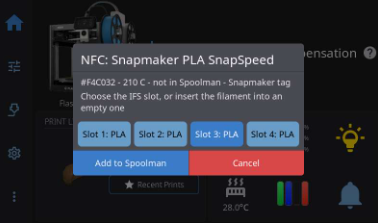
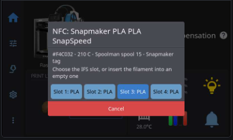
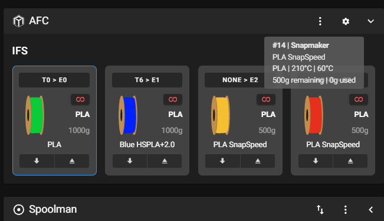

# FF_NFC

NFC/RFID filament tags and **Spoolman QR labels** for Flashforge printers,
as one plugin for two firmwares:

* **Zmod** on the **Flashforge AD5X** (four-slot IFS) and the **Flashforge
  Creator 5** (four toolheads).
* **[Kiln OS](https://github.com/djvalic/kiln-os)** on the **Flashforge
  AD5X**.

There are two ways to tell the printer which spool you are loading:

* **NFC tag:** hold a tagged spool to a USB reader plugged into the printer,
  or to a [network reader](#network-readers).
* **Spoolman QR label:** hold the spool's printed Spoolman label up to the
  printer's own camera. No extra hardware is needed. See
  [Spoolman QR labels](#spoolman-qr-labels).

Either way, a prompt asks which IFS slot or toolhead the spool goes in. You
pick one, or simply insert the filament into an empty slot, and the slot gets
the spool's material and color (on Kiln OS also its nozzle temperature). If
Spoolman is set up, the slot also gets the Spoolman spool.

```
NFC tag  ──► decode (Bambu, Creality, OpenSpool, OpenPrintTag, ...) ─┐
QR label ──► camera ──► decode (Spoolman label, OpenSpool, text) ────┤
                                                                     ▼
         look up in Spoolman (spool ID from the tag or label, or the tag's UID)
         ──► prompt: [Slot 1] [Slot 2] [Slot 3] [Slot 4]  or insert filament
         ──► Zmod:     slot color + material  (+ Spoolman spool via zmod_afclite)
             Kiln OS:  IFS_SET_MATERIAL type, color, temperature
                       (+ SPOOLMAN_SET_SLOT with Kiln's spoolman plugin)
```

FF_NFC was **zmod_nfc** (Zmod) and **KILN_NFC** (Kiln OS) until v0.2.0. To
move from either, see [Moving from zmod_nfc or KILN_NFC](#moving-from-zmod_nfc-or-kiln_nfc).

> **Status: early release.** On **Zmod**, tested end to end on an **AD5X**
> and a **Creator 5**: NFC tags with an **ACR122U** reader (and a **PN532**
> on the Creator 5), and printed Spoolman QR labels with each printer's
> camera (scan, prompt, slot assignment and filament insert). On **Kiln OS**
> (AD5X), the plugin loads, a CH340 "PN532 V2.0" board works through
> FF_NFC's own USB serial driver, and camera QR scanning reads generated
> codes; a tag read into a slot and a printed label have not been tried
> there yet. The decoders, the QR reader, both platforms' Klipper
> integration and the USB plumbing have unit tests, which pass under
> Python 3.8 (Zmod) and 3.14 (Kiln OS). The ACR1552U, PN5180 and RC522
> drivers have **not yet been run against physical readers**. Reports are
> very welcome (see [Reporting a tag](#reporting-a-tag)).

## Readers

| Reader | Connection | Tags | Notes |
|--------|------------|------|-------|
| **ACR1552U** | USB (CCID) | ISO 14443A + ISO 15693 | Plug in. Driven directly over usbfs; no pcscd needed. |
| **ACR122U** | USB (CCID) | ISO 14443A | Tested. MIFARE Classic is read through its internal PN532. |
| Other PC/SC readers: ACR1252U, ACR1255U, Identiv, ... | USB (CCID) | depends on the reader | Same driver: any reader with the PC/SC Part 3 storage-card commands. |
| **PN532** | USB-serial adapter (CH340, CP210x, PL2303, FTDI) | ISO 14443A | Tested with an all-in-one USB-C "PN532 V2.0" board (CH340E, HSU wired in). On other boards, set **HSU/UART** mode (both switches off on the common red and blue boards). Cannot read ISO 15693 (OpenPrintTag). |
| **[esp32_rfidnfc2usb_bridge](https://github.com/DIEHARDave/esp32_rfidnfc2usb_bridge)** | USB: an ESP32 with a PN532 (I2C or UART), an RC522 or a PN5180 (both SPI), which FF_NFC sees as a PN532 | ISO 14443A | One small board for any of the three chips; no setting needed (`reader: auto` or `pn532`). Tested with a PN532 on an ESP32-C3 on an AD5X; RC522 and PN5180 untested on hardware. See [USB bridge for PN532, RC522 and PN5180](#usb-bridge-for-pn532-rc522-and-pn5180). |
| **PN5180** | USB through [esp32_rfidnfc2usb_bridge](#usb-bridge-for-pn532-rc522-and-pn5180) | ISO 14443A (ISO 15693 not yet through the bridge) | The PN5180 has no USB of its own. Through the bridge it reads like a PN532; FF_NFC does not use the bridge's ISO 15693 commands yet, so OpenPrintTag needs an ACR1552U or LaneTag for now. |
| **RC522** (MFRC522) | USB through [esp32_rfidnfc2usb_bridge](#usb-bridge-for-pn532-rc522-and-pn5180) | ISO 14443A | SPI only, so it needs the bridge. Power it from 3.3 V. Cannot read ISO 15693 (OpenPrintTag). |
| **[LaneTag](https://github.com/DIEHARDave/LaneTag)** | Wi-Fi: an ESP32 with a PN532 (I2C or HSU), an RC522 (SPI) or a PN5180 (SPI) | ISO 14443A; also ISO 15693 with a PN5180 | A reader anywhere on the network, for one or several printers. No bridge needed: the ESP32 drives the RC522 and PN5180 itself. See [Network readers](#network-readers). |

`reader: auto` (the default) uses the first CCID reader it finds, then probes
USB-serial adapters for a PN532 (an esp32_rfidnfc2usb_bridge answers as one,
whatever chip it carries) or a PN5180/RC522 bridge. It never probes serial
ports that a Klipper MCU uses, or ports from unknown USB vendors.

**Kiln OS on the AD5X** runs Flashforge's own 5.10 kernel, which has **no
USB serial drivers** (no `ch341`, `cp210x` or `cdc_acm`): a PN532 board or
an ESP32 never gets a `/dev/ttyUSB*` or `/dev/ttyACM*`. FF_NFC drives the
CH340, CP210x and CDC-ACM (ESP32-C3/S3/C6 native USB) chips itself over
usbfs, so they work anyway, once the [root hook](#kiln-os) gives Klipper
access to them. PL2303 and FTDI adapters only work on a kernel that has
their drivers.

Everything uses the Python standard library: no pyserial, libusb, pcscd or
pyscard. Neither firmware's Python ships them, and building them for the
AD5X's MIPS CPU is impractical.

## Tag formats

| Format | Tag | Readers | Notes |
|--------|-----|---------|-------|
| [OpenPrintTag](https://specs.openprinttag.org) (Prusa) | ICODE SLIX2 (ISO 15693) | ACR1552U, PN5180 (USB or LaneTag) | CBOR. Remaining weight from the aux region. |
| [OpenSpool](https://openspool.io) | NTAG21x | all | JSON NDEF record. |
| [OpenTag3D](https://opentag3d.info) | NTAG21x / ISO 15693 | all | Spec 2.x, and the older 0.012 layout. |
| [TigerTag](https://tigertag.io) | NTAG21x | all | Offline ID database. |
| Bambu Lab | MIFARE Classic 1K | ACR1552U, PN532, PN5180, RC522 | Works out of the box. |
| Creality (CFS) | MIFARE Classic 1K | ACR1552U, PN532, PN5180, RC522 | Works out of the box, encrypted tags included. |
| Snapmaker (U1) | MIFARE Classic 1K | ACR1552U, PN532, PN5180, RC522 | Works out of the box: the key derivation is [published](https://github.com/DnG-Crafts/U1-RFID/blob/main/docs/U1%20Tag%20Protocol.md). The tag's RSA signature is not checked, so re-written tags read too. |
| Anycubic (ACE) | NTAG21x | all | |
| Elegoo | NTAG21x | all | |
| Qidi | MIFARE Classic 1K | ACR1552U, PN532, PN5180, RC522 | |
| [SpoolEase](https://spoolease.io) | NTAG21x | all | URL record. |
| Spoolman references | any NDEF tag | all | `web+spoolman:s-<id>` / `.../spool/show/<id>` links, and [nfc2klipper](https://github.com/bofh69/nfc2klipper) `SPOOL:<id>` text. The same links work as [QR labels](#spoolman-qr-labels). |
| Plain text | any NDEF tag | all | `PLA:FF0000`, `PETG #00FF00`, `PLA Silk;123456;Brand`. Also as QR codes. |
| NDEF on MIFARE Classic, Type 4 (DESFire) | | ACR1552U, PN532 | All of the NDEF formats above. |
| Any other tag | | all | Its UID is still matched against Spoolman spools. |

**Vendor keys:** the Bambu, Creality and Snapmaker keys are built in, from
their public write-ups (the
[Bambu Research Group RFID guide](https://github.com/Bambu-Research-Group/RFID-Tag-Guide),
the Creality CFS RFID research and the
[DnG-Crafts U1 Tag Protocol](https://github.com/DnG-Crafts/U1-RFID/blob/main/docs/U1%20Tag%20Protocol.md)),
so these tags read without any setup. The `bambu_key`, `creality_key`,
`creality_encryption_key` and `snapmaker_key` options can override them; an
override is checked against the key's known SHA-256 at startup.

## Install

### Zmod

1. Add the section in
   [`ff_nfc.moonraker.conf.example`](ff_nfc.moonraker.conf.example) to
   `mod_data/user.moonraker.conf`, then restart Moonraker. Moonraker's update
   manager now keeps the plugin up to date (release tags only).
2. Run:

   ```gcode
   ENABLE_PLUGIN name=ff_nfc
   ```

Zmod clones the repository into `mod_data/plugins/ff_nfc` and runs
`install.sh`, which links `ff_nfc.py` into Klipper's extras directory
(native Klipper and Klipper 13). Zmod then restarts Klipper. The plugin works
with its defaults.

To remove it, run `DISABLE_PLUGIN name=ff_nfc`.

### Kiln OS

Over SSH as root (Kiln's default password is `root`):

```sh
cd /data/ad5x/plugins
su klipper -s /bin/sh -c 'git clone https://github.com/DIEHARDave/FF_NFC.git ff_nfc'
sh /data/ad5x/plugins/ff_nfc/install.sh
```

Then in the console (Fluidd, Mainsail or HelixScreen):

```
ENABLE_PLUGIN NAME=ff_nfc
```

This restarts Klipper. Plug the reader in and run `NFC_STATUS`: it names
the reader once it is found, and says what is missing if it isn't.
Fluidd > Settings > Software Updates then lists `ff_nfc` (release tags
only). After an update, `RESTART` Klipper; if `NFC_STATUS` then says the
USB hook is outdated, run `install.sh` again as root.

**The root hook** (`install.sh`) is needed for USB readers and for the scan
beep on the stock kernel (see [Beeps](#beeps)); network readers work
without it. Kiln's `/dev/bus/usb` nodes belong to root, and a plugin runs
as user `klipper`. `install.sh` copies `root/ff-nfc-hook.sh` to
`/data/ad5x/ff-nfc-hook.sh` and adds a line to `/data/ad5x/screen.conf`,
which Kiln's screen service sources as root at every boot. The hook runs a
small watcher that, whenever USB devices come or go, gives group `klipper`
access to devices that can be readers: CCID-class devices and USB serial
chips from the vendors above. It also gives group `klipper` the speaker's
PWM device (`/dev/jz_pwm`). Nothing else is changed.

> **The hook is a stopgap.** Kiln OS has no boot hook for plugins, and
> `screen.conf` is the one root-sourced file left to use. A later Kiln
> release may close that too; then run `sh /data/ad5x/ff-nfc-hook.sh` as
> root after each reboot. A proper hook was requested in
> [djvalic/kiln-os#13](https://github.com/djvalic/kiln-os/issues/13).

To remove the plugin: `DISABLE_PLUGIN NAME=ff_nfc`, `sh uninstall.sh` as
root, then delete `/data/ad5x/plugins/ff_nfc`.

## Moving from zmod_nfc or KILN_NFC

The Klipper section is now `[ff_nfc]` and the plugin is `ff_nfc` on both
firmwares; the `NFC_*` commands are unchanged, so macros keep working.
Slots set before keep their Spoolman spools and lane data.

**From zmod_nfc (Zmod):**

1. `DISABLE_PLUGIN name=zmod_nfc`
2. In `mod_data/user.moonraker.conf`, replace the `[update_manager zmod_nfc]`
   section with the one in
   [`ff_nfc.moonraker.conf.example`](ff_nfc.moonraker.conf.example), and
   restart Moonraker.
3. If `mod_data/user.cfg` has a `[zmod_nfc]` section, rename it to
   `[ff_nfc]`.
4. `ENABLE_PLUGIN name=ff_nfc`, then delete `mod_data/plugins/zmod_nfc`.

**From KILN_NFC (Kiln OS):**

1. `DISABLE_PLUGIN NAME=nfc`
2. [Install FF_NFC](#kiln-os). Its `install.sh` also removes KILN_NFC's
   hook (`nfc-hook.sh`) and its `screen.conf` lines.
3. If `local.cfg` has a `[kiln_nfc]` section, rename it to `[ff_nfc]`.
4. `ENABLE_PLUGIN NAME=ff_nfc`, then delete `/data/ad5x/plugins/nfc`.

LaneTag finds FF_NFC by itself from its next release on; until a printer is
moved over, it keeps talking to zmod_nfc there.

## Configuration

[`ff_nfc.cfg`](ff_nfc.cfg) lists every option (Kiln OS includes it through
`plugin.cfg`). Plugin updates replace that file, so put your settings in a
section of your own, in `mod_data/user.cfg` on Zmod or `local.cfg` on Kiln
OS:

```ini
[ff_nfc]
prompt_timeout: 90
spoolman_auto_create: True
```

Klipper merges both `[ff_nfc]` sections, and yours wins. Options for the
other firmware are accepted and ignored, so the same section works on every
printer. The QR label options start with `qr_`; see
[Spoolman QR labels](#spoolman-qr-labels).

## Using it

A Snapmaker spool scanned for the first time, shown on HelixScreen. It is not
in Spoolman yet, so the prompt offers **Add to Spoolman**:



The same spool after adding it, now matched to Spoolman spool 15:



1. Hold a tag to the reader (or scan a [QR label](#spoolman-qr-labels)). A
   prompt appears in Mainsail, Fluidd and HelixScreen, showing the filament
   and one button per IFS slot (or `T0`-`T3` on the Creator 5). Empty slots
   are highlighted.
2. Tap a slot, **or insert the filament into an empty slot** within the
   prompt timeout. Inserting also works on screens that cannot show prompts,
   such as the stock Flashforge screen.
3. The slot gets the spool:
   * **Zmod:** material and color. On the Creator 5, the color is snapped to
     the closest color in its palette for Zmod's screen; lane_data
     (OrcaSlicer, HelixScreen) keeps the tag's exact color.
   * **Kiln OS:** material, exact color and nozzle temperature through
     Kiln's `IFS_SET_MATERIAL`, so HelixScreen, auto-refill and OrcaSlicer
     (through Kiln's lane data) see it. Kiln takes any material name, so
     the tag's material is kept as it is (ASA stays ASA, `PLA Silk` becomes
     `PLA-SILK`). `set_temperature: False` leaves the temperature alone.

Zmod normally asks for the color and material after you insert filament
(after the AD5X IFS loads it, or when a Creator 5 head sensor sees it). For a
slot set from a tag, FF_NFC skips that popup. If the tag's prompt is still
open when the popup would appear, FF_NFC assigns the spool to that slot
instead. Set `skip_zmod_color_prompt: False` to keep Zmod's popup.

Tags are ignored, and QR scanning is off, while printing unless
`scan_while_printing: True`.

### Beeps

The printer's speaker beeps after each scan: a short high beep when the tag
was read, a longer low one when it left the reader too soon or has no
filament data (or was ignored while printing). `beep: False` turns it off;
`scan_gcode` / `scan_error_gcode` run a macro instead. `NFC_STATUS` shows
whether the speaker was found.

Zmod's `M300` does not reach the AD5X speaker, so the plugin drives it with
Flashforge's `cmd_pwm` directly. On Kiln's own kernel the beep goes through
Kiln's `ad5x-sound`. On the stock Flashforge kernel Kiln finds no speaker
and its `M300` is silent; FF_NFC then uses `cmd_pwm` too, with the
printer's vendor libraries. Kiln doesn't ship `cmd_pwm`, so this works on
printers that ran Zmod before (its copy is still in `/data/config/mod_data`),
and needs the [root hook](#kiln-os).

### With Spoolman

When Moonraker has a `[spoolman]` section:

* A tag or QR label that names a spool (a Spoolman label or link,
  nfc2klipper `SPOOL:`, OpenSpool `spool_id`) selects that spool.
* Otherwise the tag's UID is looked up in the spools' `card_uids` field (the
  same field [zmod_afclite](https://github.com/DIEHARDave/zmod_afclite) uses),
  in Spoolman's own tag list (Spoolman 0.27 and later) or in nfc2klipper's
  `nfc_id` field.
* Then, with `spoolman_match_filament: True` (the default), a tag with
  filament data matches the spool whose filament has the tag's vendor,
  material and exact color - if there is only one. This finds a Snapmaker
  spool by its second tag, or a spool added by hand; the tag's UID is then
  recorded on it (see `bind_card_uid`).
* An unknown tag that carries filament data can be added with the prompt's
  **Add to Spoolman** button, or automatically with
  `spoolman_auto_create: True`.
* With `bind_card_uid: True` (the default), assigning a spool records the
  tag's UID on it, so the same tag is recognized next time even if it has no
  data of its own.

On **Zmod** with **zmod_afclite** installed, assigning a Spoolman spool goes
through its `SET_SPOOL_ID`. Each IFS lane then tracks its own spool, and
Moonraker's active spool follows whichever lane is loaded. Without
zmod_afclite, FF_NFC writes the color and material itself, saves the spool
ID per slot in `save_variables`, and sets the active spool when the slot is
the one loaded.

On **Kiln OS** with **Kiln's spoolman plugin** on (`INSTALL_PLUGIN
NAME=spoolman ENABLE=1`), the assignment runs `SPOOLMAN_SET_SLOT`: each
slot keeps its spool, and the spool becomes Moonraker's active spool
whenever that slot loads. Without it, the spool is made active only when
its slot is the one loaded at the time.

Two Snapmaker spools assigned from their tags to IFS lanes E2 and E3, in
zmod_afclite's AFC panel in Mainsail. Hovering over a lane's spool shows its
Spoolman details:



Without Spoolman, only the tag's material and color are used.

### Lane data for OrcaSlicer and HelixScreen

After an assignment, FF_NFC adds the spool's details to the slot's entry
in Moonraker's `lane_data` (which OrcaSlicer and HelixScreen read):
material, color, Spoolman `spool_id`, name, vendor and nozzle and bed
temperatures. The entry is found by its `lane` field, so this works with
the AD5X's `lane1`..`lane4` and the Creator 5's `T0`..`T3` keys alike. Set
`lane_data: False` to turn it off.

* **Zmod:** other keys in the entry, such as zmod_afclite's, are kept.
* **Kiln OS:** Kiln's own record for the slot uses a key that HelixScreen
  mistakes for one of its own, so HelixScreen would ignore the change and
  keep showing a color once picked on its screen. FF_NFC rewrites the
  record right after Kiln does, so HelixScreen shows the scanned spool.

## Network readers

[LaneTag](https://github.com/DIEHARDave/LaneTag) is an ESP32
with a PN532 (I2C or HSU), an RC522 or a PN5180 (both SPI) that reads tags
over Wi-Fi, so one reader can serve several
printers and does not need a USB port on the printer. It sends the **whole
tag read** (UID, memory dump, which MIFARE keys opened which sector) to
FF_NFC, which treats it exactly like a tag on a USB reader: every format
is decoded here, the spool is looked up in Spoolman, the slot prompt appears
on the printer's screen, inserting filament picks the slot, and lane data is
filled in. The ESP32's web page can also pick the slot, or a reader can be
fixed to one slot (one reader per IFS slot or toolhead): its scans then go
straight into that slot, without the prompt. This works the same on Zmod
and Kiln OS.

Readers talk to FF_NFC **through Moonraker** (port 7125): FF_NFC
registers Klipper endpoints (`ff_nfc/scan`, ...) that Moonraker publishes
on its HTTP API. There is no extra port or server on the printer, and
Moonraker's authorization applies (a reader outside `trusted_clients` needs
an API key). The protocol is in [docs/remote-api.md](docs/remote-api.md).

## USB bridge for PN532, RC522 and PN5180

[esp32_rfidnfc2usb_bridge](https://github.com/DIEHARDave/esp32_rfidnfc2usb_bridge)
is ESP32 firmware that puts a PN532, an RC522 or a PN5180 on the printer's
USB port. The printer sees **a PN532 on a USB serial port** whichever chip is
fitted, so FF_NFC uses its PN532 driver for all three. There is nothing to
configure here: `reader: auto` (the default) finds the bridge, as does
`reader: pn532`.

- **PN532**: the bridge passes commands through to the chip.
- **RC522 / PN5180**: the bridge emulates a PN532 for ISO 14443A tags: NTAG,
  MIFARE Classic (so Bambu, Creality, Snapmaker and Qidi tags read as usual)
  and Type 4.
- **Boards**: ESP32-C3, S2, S3 and C6 show up as a USB CDC-ACM port
  (`/dev/ttyACM0` on Zmod; driven over usbfs on Kiln OS). Classic ESP32
  boards use their CP210x or CH340 chip.

The bridge also reads ISO 15693 tags (OpenPrintTag) on a PN5180 through
commands of its own, but FF_NFC does not use them yet. Wiring, pins and
flashing are in the bridge's README.

**Status:** a PN532 on I2C through an ESP32-C3 bridge was found and read on
an AD5X with Zmod, and on a PC this driver decoded an OpenSpool NTAG216
through it. The RC522 and PN5180 through the bridge have not been run on
hardware yet.

(The thin SPI bridge protocol in [docs/pn5180-bridge.md](docs/pn5180-bridge.md),
where FF_NFC's own PN5180 and RC522 drivers do the chip work, has no
firmware. The esp32_rfidnfc2usb_bridge covers the same chips.)

## Spoolman QR labels

[Spoolman](https://github.com/Donkie/Spoolman) prints a QR code label for
each spool. FF_NFC reads those labels with the printer's camera, so a
spool with a Spoolman label can be loaded without an NFC reader or tag.

### Printing labels

Print the labels from Spoolman's web UI: select spools and choose to print
QR code labels. Either QR content works:

| Spoolman QR content | Example | |
|---------------------|---------|--|
| Compact code (the default) | `WEB+SPOOLMAN:S-15` | Smallest code, easiest to read at a distance. |
| HTTP link | `http://spoolman.local:7912/spool/show/15` | Also opens the spool in a phone's browser. Makes a denser code. |

These are **spool** labels. Spoolman can also print **filament** labels
(`WEB+SPOOLMAN:F-<id>`, `.../filament/show/<id>`); those name a filament, not
a spool, so FF_NFC does not use them to set a slot.

Print the code large enough for the camera. Each of its small squares needs
about 2 to 3 camera pixels, so a bigger code reads from further away, and
the compact code beats the link at the same size.

### Scanning a label

1. Run `NFC_QR_SCAN`, or tap the **SCAN_QR_LABEL** macro in Mainsail, Fluidd
   or HelixScreen.
2. A prompt asks you to hold the label up to the camera. Hold it still,
   facing the camera and well lit, until the slot prompt appears. Laying it
   flat on the bed also works, but a label seen at a steep angle needs to be
   larger.
3. The slot prompt shows the Spoolman spool. Pick a slot or toolhead, or
   insert the filament into an empty one, exactly as with an NFC tag.

The scan keeps looking for up to 20 seconds (`qr_scan_time`, or
`NFC_QR_SCAN TIME=<s>`). If it finds nothing, the prompt says so and offers
**Try again**. `NFC_QR_CANCEL` stops it.

| Printer | Camera | Time per frame |
|---------|--------|----------------|
| AD5X, Zmod | 2048x1536, **3rd-party camera**, above and in front of the bed | about 2 s |
| Creator 5, Zmod | 1280x720, low, looking across the bed | about 2.3 s |
| AD5X, Kiln OS | 1280x720, decoded at half size | about 1 s |

In testing on Zmod, a printed Spoolman label was read within about 5
seconds on both printers, then assigned through zmod_afclite. Reports from
other setups and camera models are welcome.

A label points at a spool, but unlike an NFC tag it has no UID of its own, so
`bind_card_uid` does not apply to it. The spool must exist in Spoolman; a
label for a spool that has since been deleted gets "not in Spoolman".

### Other QR codes

The camera also reads QR codes made with any QR generator, using the same
formats as NFC tags: [OpenSpool](https://openspool.io) JSON
(`{"protocol":"openspool","type":"PLA","color_hex":"FF0000",...}`) and the
plain-text forms (`PLA:FF0000`, `PETG #00FF00`, `PLA Silk;123456;Brand`).
These work without Spoolman. Codes up to version 10 (271 bytes) are read.

### Settings

| Option | Default | |
|--------|---------|--|
| `qr_scan_time` | `20` | Seconds to keep looking. |
| `qr_snapshot_url` | Zmod: `http://127.0.0.1:8080/?action=snapshot`, Kiln OS: `http://127.0.0.1:8090/?action=snapshot` | Camera snapshot URL. The defaults are each firmware's first camera. |
| `qr_width` | Zmod: `1024`, Kiln OS: `640` | Large frames are scaled down towards this width; small codes are read again from a full-resolution crop. |
| `qr_decoder` | `auto` | JPEG decoder: `pillow` (Kiln OS ships it), `turbojpeg` (libturbojpeg in Zmod's chroot), `ffmpeg`, or `auto` (the first of these that is available). |
| `qr_chroot` | `/usr/data/.mod/.zmod` | Zmod: the chroot holding python3 and libturbojpeg. |
| `qr_ffmpeg` | | Path to ffmpeg; empty finds one on PATH or under `/usr/prog`. |

### If a label is not read

* Each scan keeps its camera frames in `/tmp/ff_nfc_qr/` on the printer.
  Look at them to see what the camera saw: often the label is too small, out
  of the picture, blurred by movement, or washed out by glare.
* The Klipper log has the time each frame took (`ff_nfc: camera frame ...`).
* After a scan, `NFC_DUMP` shows the QR code's text.
* A saved frame can be tried again by hand, over SSH. On Zmod (AD5X and
  Creator 5):

  ```sh
  cd /opt/config/mod_data/plugins/ff_nfc/python
  LD_LIBRARY_PATH=/usr/prog/Python-3.8.2/lib:/usr/prog/openssl-1.0.2d/lib \
    /usr/prog/Python-3.8.2/bin/python3 -m ffnfc.camera \
    --image /tmp/ff_nfc_qr/frame01.jpg --verbose
  ```

  On Kiln OS:

  ```sh
  cd /data/ad5x/plugins/ff_nfc/python
  python3 -m ffnfc.camera --image /tmp/ff_nfc_qr/frame01.jpg --verbose
  ```

  It prints the code's text, e.g. `{"frames": 1, "text": "WEB+SPOOLMAN:S-5"}`,
  or `"no QR code found"`.

### How it works

`NFC_QR_SCAN` starts a low-priority child process (`python/ffnfc/camera.py`),
so Klipper itself does none of the image work. It fetches snapshots from the
camera streamer and turns each into a grayscale frame: with Pillow on Kiln
OS, with libturbojpeg in Zmod's chroot on Zmod (or with the firmware's
ffmpeg where its build can; the Creator 5's cannot). A QR reader written in
pure Python (`python/ffnfc/qr.py`) then decodes it. The reader copes with
labels that are turned, tilted, or foreshortened to a third of their
height, as a label lying on the bed looks to the Creator 5's low camera.
The text it finds then takes the same path as an NFC tag's: the decoders,
the Spoolman lookup and the slot prompt.

## Commands

| Command | |
|---------|--|
| `NFC_STATUS` | Reader state, the last tag, enabled formats and keys, and on Kiln OS any problem with the USB hook. |
| `NFC_ASSIGN SLOT=<n>` | Assign the scanned spool to a slot (the prompt's buttons run this). |
| `NFC_CANCEL` | Close the prompt. |
| `NFC_PROMPT` | Show the prompt for the last tag again. |
| `NFC_CREATE_SPOOL` | Add the scanned filament to Spoolman. |
| `NFC_DUMP [RAW=1]` | Everything read from the last tag; `RAW=1` adds a memory dump. |
| `NFC_RESCAN` | Read the tag on the reader again. |
| `NFC_TEST_SCAN TEXT=PLA:FF0000` / `SPOOL=<id>` / `UID=<hex>` | Simulate a scan, to try the prompt and Spoolman flow without a reader. |
| `NFC_QR_SCAN [TIME=<s>]` | Read a Spoolman QR label with the printer camera (the `SCAN_QR_LABEL` macro runs this). |
| `NFC_QR_CANCEL` | Stop looking for a QR label. |
| `NFC_ENABLE` / `NFC_DISABLE` | Resume or ignore scans. |

`printer.ff_nfc` reports `state`, `reader`, `error`, `pending`,
`qr_scanning`, `remote` (the outcome of the last network reader scan) and
the `last` scan (UID, format, material, color, spool ID) for macros and
other clients. A QR scan has an empty UID.

## Testing a reader without Klipper

[`tools/nfc_scan.py`](tools/nfc_scan.py) lists USB devices, reads tags and
prints what it finds. Stop the plugin from holding the reader first, for
example with `DISABLE_PLUGIN`, or run it before enabling the plugin:

```sh
# Zmod (AD5X, Creator 5), over SSH
chroot /usr/data/.mod/.zmod python3 /opt/config/mod_data/plugins/ff_nfc/tools/nfc_scan.py --list
chroot /usr/data/.mod/.zmod python3 /opt/config/mod_data/plugins/ff_nfc/tools/nfc_scan.py --raw

# Kiln OS, over SSH as root
python3 /data/ad5x/plugins/ff_nfc/tools/nfc_scan.py --list
python3 /data/ad5x/plugins/ff_nfc/tools/nfc_scan.py --raw
```

## Reporting a tag

If a tag isn't recognized, scan it and run `NFC_DUMP RAW=1` (or
`tools/nfc_scan.py --raw --json`). Then open an issue with the output and
what the spool is. Remove anything private first.

## Development

```sh
python3 -m unittest discover -s tests
```

The reader tests need a POSIX system (`fcntl`, `termios`): Linux or macOS,
or WSL on Windows. Keep the code compatible with Python 3.8, which is what
Klipper runs under on Zmod; Kiln OS runs 3.14. The Pillow camera tests run
when Pillow is installed.

Firmware specifics live in `python/ffnfc/platforms/`: `zmod.py` and
`kiln.py` read and set the slots, pick the lane_data writer and the camera
defaults. Everything else is shared. `ff_nfc.py` is the Zmod entry point
(linked into Klipper's extras by `install.sh`), `extras/ff_nfc.py` the Kiln
OS one (Kiln loads `plugin.json`, `plugin.cfg`, `extras/` and `python/`).

The QR tests decode reference codes in `tests/vectors/qr/codes.json`. To
regenerate them, run `tests/vectors/qr/make_codes.py`, which needs
[segno](https://github.com/heuer/segno) (`pip install segno`); the plugin and
the tests themselves do not.

## Credits

* [OpenRFID](https://github.com/suchmememanyskill/OpenRFID) (GPL-3.0). The
  Bambu, Creality, Snapmaker, Qidi, Anycubic, Elegoo, TigerTag, OpenSpool,
  OpenTag3D and SpoolEase decoders are adapted from it, as is the bundled
  TigerTag ID database. OpenRFID builds on the
  [Bambu Research Group RFID guide](https://github.com/Bambu-Research-Group/RFID-Tag-Guide)
  and [DnG-Crafts ACE-RFID](https://github.com/DnG-Crafts/ACE-RFID).
* Snapmaker U1 tag research by
  [DnG-Crafts](https://github.com/DnG-Crafts/U1-RFID),
  [SnapmakerResearchGroup](https://github.com/SnapmakerResearchGroup/RFID) and the
  [Proxmark3](https://github.com/RfidResearchGroup/proxmark3) key generator.
* [OpenPrintTag](https://github.com/prusa3d/OpenPrintTag) by Prusa Research.
  The test vectors in `tests/vectors/openprinttag` are MIT licensed; see the
  LICENSE file there.
* [Spoolman](https://github.com/Donkie/Spoolman) by Donkie, whose QR labels
  FF_NFC reads. The QR reader in `python/ffnfc/qr.py` is written from the QR
  code standard (ISO/IEC 18004) and follows the detector design ZXing made
  common. Its reference codes were made with [segno](https://github.com/heuer/segno).
* [nfc2klipper](https://github.com/bofh69/nfc2klipper) and
  [klipper-nfc-daemon](https://github.com/DIEHARDave/klipper-nfc-daemon) for
  the Spoolman conventions and the scan-then-pick-a-slot flow.
* [Kiln OS](https://github.com/djvalic/kiln-os) by djvalic. The USB serial
  chip setup follows the Linux kernel's `ch341`, `cp210x` and `cdc-acm`
  drivers.

## License

GPL-3.0-or-later. See [LICENSE](LICENSE).
